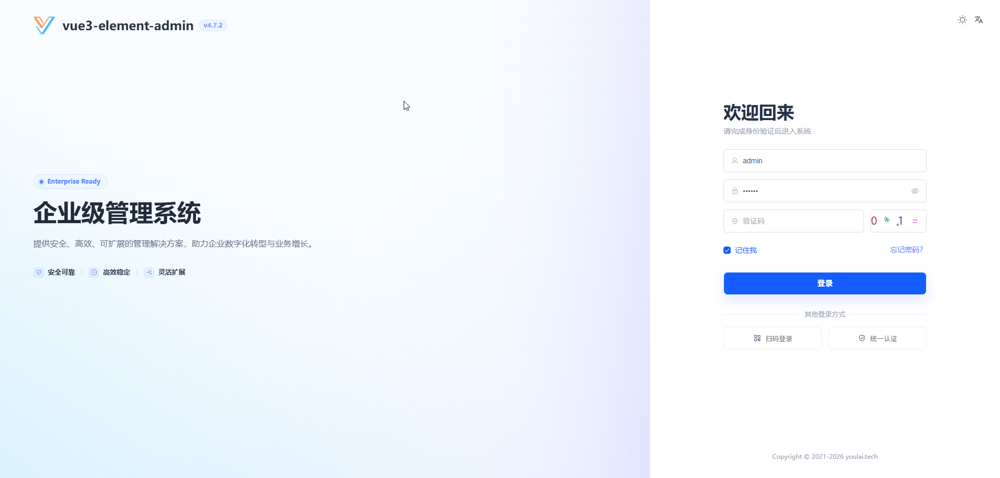
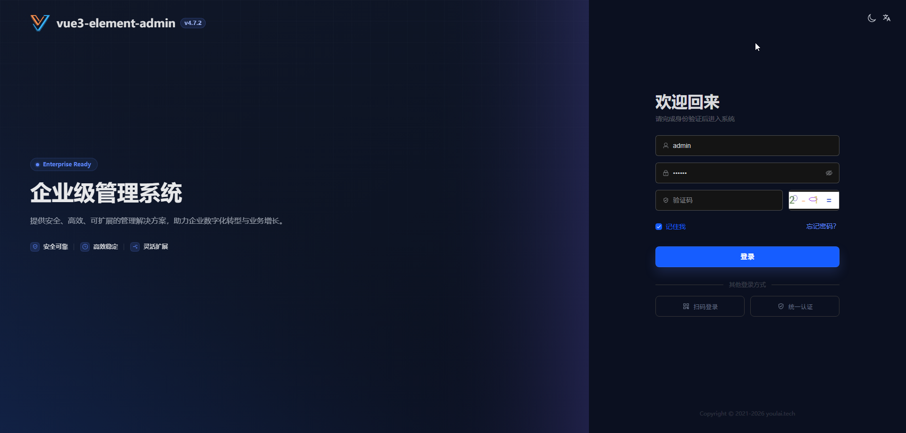
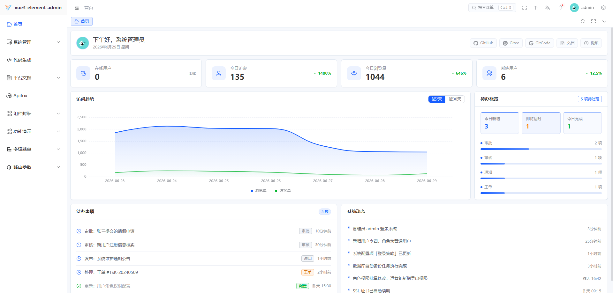
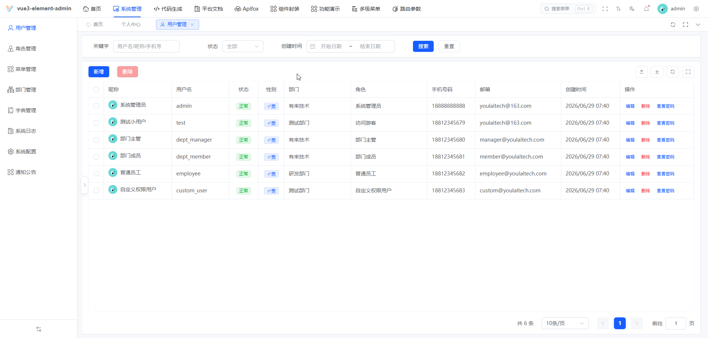
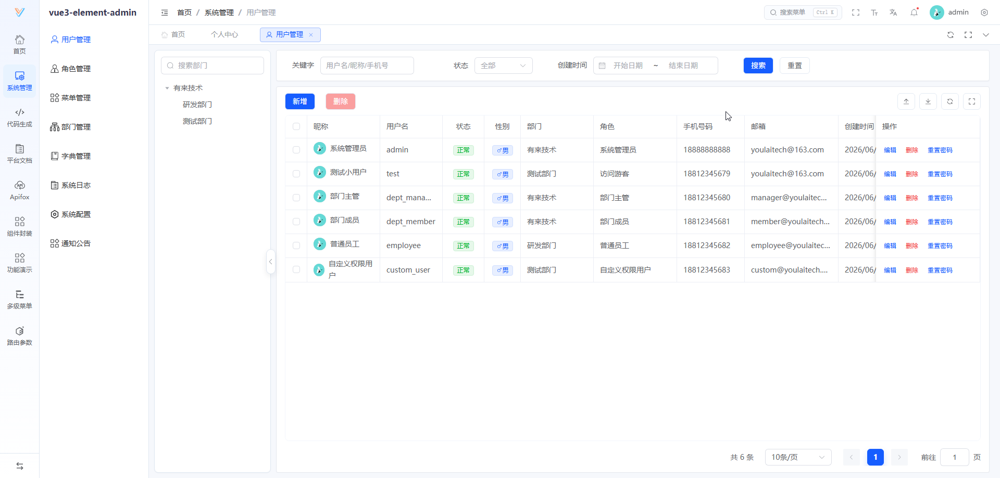
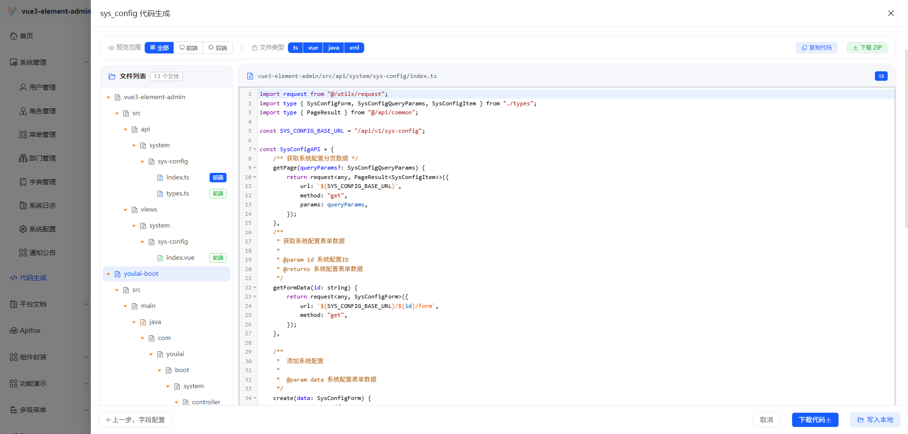
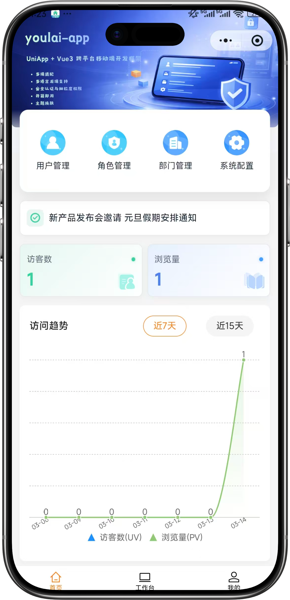
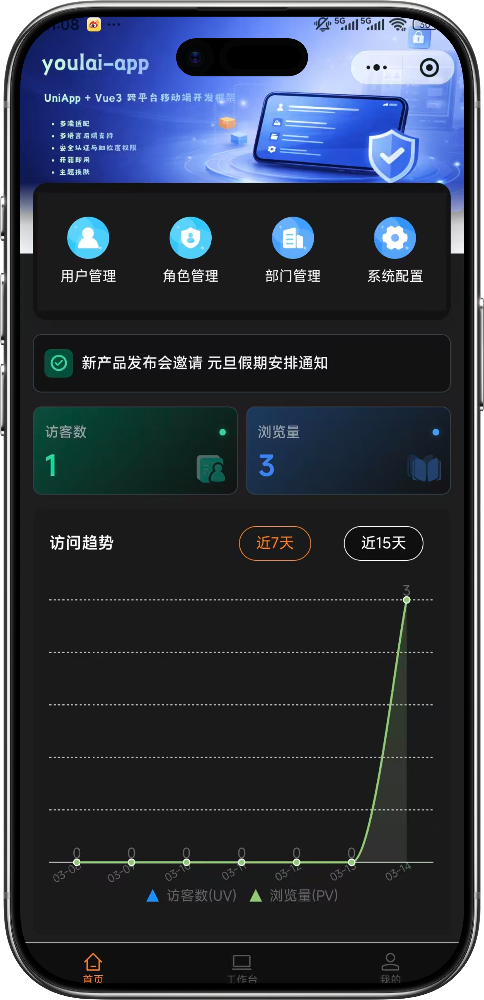
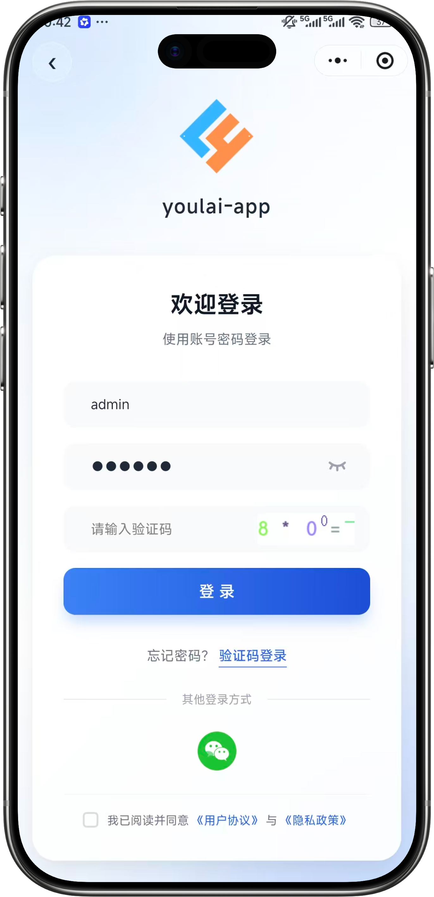
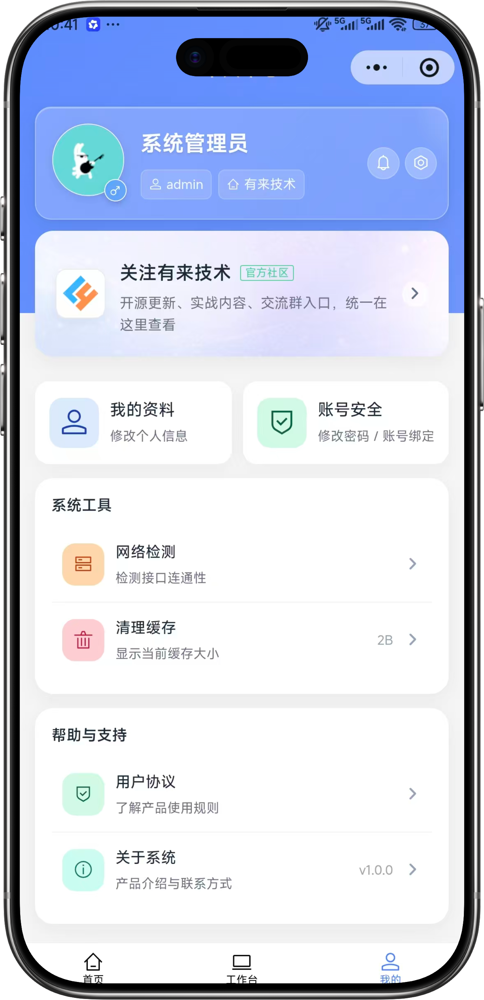

<div align="center">

#  youlai-django

**Python 3.12 + Django 6.0 Enterprise-Grade Permission Management Backend**

<br>

[](https://www.python.org/)
[](https://www.djangoproject.com/)
[](LICENSE)
[](https://gitee.com/youlaiorg/youlai-django/stargazers)
[](https://github.com/youlaitech/youlai-django)

</div>

<p align="center"></p>

<div align="center">

[](https://admin.youlai.tech)
[](https://app.youlai.tech)
[](https://www.youlai.tech/docs/server/spring-boot/)
[](./README.md)

</div>

## Introduction


**youlai-django** is an enterprise-grade permission management backend built on Django / DRF. It ships with the frontend [vue3-element-admin](https://gitee.com/youlaiorg/vue3-element-admin) and the mobile app [youlai-app](https://gitee.com/youlaiorg/youlai-app), and is one of **7 language implementations** (Java / Node.js / Go / Python / PHP / C# / Rust) that share the same API specification and database schema. It is suitable for learning, reference, and secondary development of enterprise admin systems.


## Core Features


- 🔐 **Security** — JWT + Redis Token dual-session model, token renewal, multi-device mutual exclusion

- 🛡️ **Fine-grained permissions** — RBAC model governing menus, buttons, and APIs in one place

- ⚡ **Code generator** — one-click generation of full-stack CRUD code

- 📦 **Complete modules** — users, roles, menus, departments, dictionaries, files, message center, operation logs

- 🔌 **Real-time communication** — WebSocket push: online user count, dictionary sync, notification broadcast


## System Preview


**PC**


<table align="center">

  <tr>

    <td></td>

    <td></td>

  </tr>

  <tr>

    <td></td>

    <td></td>

  </tr>

  <tr>

    <td></td>

    <td></td>

  </tr>

</table>


**Mobile**


<table align="center">

  <tr>

    <td></td>

    <td></td>

    <td></td>

    <td></td>

  </tr>

</table>


## Quick Start


> Requirements: Python 3.12+ · MySQL 8.0+ · Redis 7.x+


**1. Clone**


```bash

git clone https://gitee.com/youlaiorg/youlai-django.git

cd youlai-django

```


**2. Create a virtual environment**


Windows (PowerShell):

```powershell

python -m venv venv

venv\Scripts\activate

```


macOS / Linux:

```bash

python3 -m venv venv

source venv/bin/activate

```


**3. Install dependencies**


```bash

pip install -r requirements.txt

```


**4. Import database**


Create the business tables and seed data with `sql/mysql/youlai_admin_django.sql` (the dynamic-form extension tables live in `sql/mysql/extensions/dynamic-form.sql`). Then run the following once to create Django's built-in framework tables (auth / contenttypes / sessions / admin); it does not touch business tables. The project keeps no migration files: business schemas always come from the SQL scripts, and after changing models run `python manage.py makemigrations` plus `python manage.py migrate --fake-initial`:


```bash

python manage.py migrate

```

> **PostgreSQL**: `sql/postgresql/` ships the equivalent scripts, generated from the MySQL ones by `youlai-devkit/scripts/gen_pg_from_mysql.py` (**do not edit them by hand**). Set `DB_ENGINE=postgresql` in `.env` (default port 5432) and install `psycopg`; the order is the same: import the SQL first, then run `migrate`. Verify both dialects stay in sync with `python youlai-devkit/scripts/check_sql_parity.py`.

**5. Config file** (optional)


The repository ships with `.env`; adjust the database/Redis connection as needed. The default config works out of the box.


**6. Start the service**


```bash

python manage.py runserver 8000

```


Open http://localhost:8000/api/docs/swagger/ with default credentials `admin` / `123456`.


> See the [Deployment Docs](https://www.youlai.tech/docs/server/django/deploy) for details.


## Tech Stack


| Tech | Version | Description |

|:-----|:--------|:------------|

| Python | 3.12+ | Core language |

| Django | 6.0 | Web framework |

| DRF | 3.16 | REST API |

| SimpleJWT | 5.5 | JWT authentication |

| MySQL | 8.0+ | Database |

| Redis | 7.x | Cache · Session |

| Spectacular | 0.28 | API docs |


## Directory Structure


```

youlai-django/

├── apps/                           # Business apps (modular)

│   ├── auth/                       # Auth module (login/Token/WeChat mini-program)

│   ├── system/                     # Core system module (user/role/menu/dept/dict/notice/log)

│   ├── file/                       # File upload

│   ├── codegen/                    # Code generation

│   └── message/                    # Realtime push

├── config/                         # Project config

│   ├── settings/                   # Environment config (base/dev/prod)

│   ├── urls.py                     # Global routes

│   ├── asgi.py                     # ASGI entry

│   └── wsgi.py                     # WSGI entry

├── core/                           # Shared base capabilities

│   ├── exceptions/                 # Exception handling

│   ├── permissions/                # Permission control

│   ├── middleware/                 # Middleware

│   ├── response.py                 # Unified response format

│   ├── viewsets.py                 # Base viewsets

│   └── pagination.py               # Pagination

├── sql/                            # Database init scripts

├── manage.py                       # Django management entry

└── .env                            # Environment variables

```


## Ecosystem


**Frontend**


| Project | Stack | Description |

|:-----|:------|:------------|

| [vue3-element-admin](https://gitee.com/youlaiorg/vue3-element-admin) | Vue 3 + Element Plus | PC admin frontend (recommended) |

| [youlai-app](https://gitee.com/youlaiorg/youlai-app) | Vue 3 + UniApp | Mobile App |


**Backend**


| Project | Stack | Description |
| [youlai-boot](https://gitee.com/youlaiorg/youlai-boot) | Spring Boot + MyBatis-Plus | Java (recommended) |
| [youlai-nest](https://gitee.com/youlaiorg/youlai-nest) | NestJS + TypeORM | Node.js |
| [youlai-gin](https://gitee.com/youlaiorg/youlai-gin) | Go + Gorm | Go |
| [youlai-django](https://gitee.com/youlaiorg/youlai-django) | Django + DRF | Python |
| [youlai-fastapi](https://gitee.com/youlaiorg/youlai-fastapi) | FastAPI + SQLAlchemy | Python |
| [youlai-think](https://gitee.com/youlaiorg/youlai-think) | ThinkPHP + ThinkORM | PHP |
| [youlai-aspnet](https://gitee.com/youlaiorg/youlai-aspnet) | ASP.NET Core + EF Core | C# |
| [youlai-axum](https://gitee.com/youlaiorg/youlai-axum) | Axum + SeaORM | Rust |
> **youlai-boot** also provides the following variants and branches: [Multi-Tenant](https://gitee.com/youlaiorg/youlai-boot-tenant) · [MyBatis-Flex](https://gitee.com/youlaiorg/youlai-boot-flex) · [Spring Boot 3](https://gitee.com/youlaiorg/youlai-boot/tree/spring-boot-3) · [PostgreSQL](https://gitee.com/youlaiorg/youlai-boot/tree/db-pg) · [Multi-Module](https://gitee.com/youlaiorg/youlai-boot/tree/multi-module)

>

> The eight backends share the same **RESTful API specification** and **database schema**, so the frontend can switch seamlessly.


## Optional Extensions

**AI (off by default)**: enable it and fill the key in `.env`; `config/settings` reads these variables.

```env
AI_ENABLED=true
AI_API_KEY=sk-xxx
```

## Documentation


| Resource | Link |

|:-----|:-----|

| 📖 Full docs site | [www.youlai.tech](https://www.youlai.tech/) |

| 🖥️ PC live preview | [admin.youlai.tech](https://admin.youlai.tech) |

| 📱 Mobile live preview | [app.youlai.tech](https://app.youlai.tech) |

| 🔗 Apifox API docs | [apifox.com](https://www.apifox.cn/apidoc/shared-195e783f-4d85-4235-a038-eec696de4ea5) |

| 🔗 Local API docs | [localhost:8000/api/docs/swagger/](http://localhost:8000/api/docs/swagger/) |


## Contributing


Issues and Pull Requests are welcome! See the [Contribution Guide](https://www.youlai.tech/faq/help).


## License


Released under the [Apache License 2.0](LICENSE); free for commercial use.


---


<table align="center">

  <tr>

    <td align="center">

      <br>

      <sub>Official WeChat Account</sub>

    </td>

    <td>&nbsp;&nbsp;&nbsp;&nbsp;</td>

    <td align="center">

      <br>

      <sub>Mini Program</sub>

    </td>

    <td>&nbsp;&nbsp;&nbsp;&nbsp;</td>

    <td align="center">

      <br>

      <sub>Add author on WeChat</sub>

    </td>

  </tr>

</table>


<p align="center"><em>Technical discussion · Feedback · Business cooperation</em></p>

