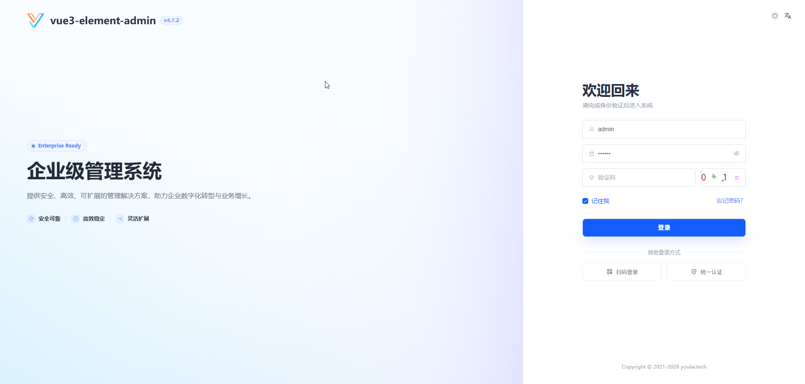
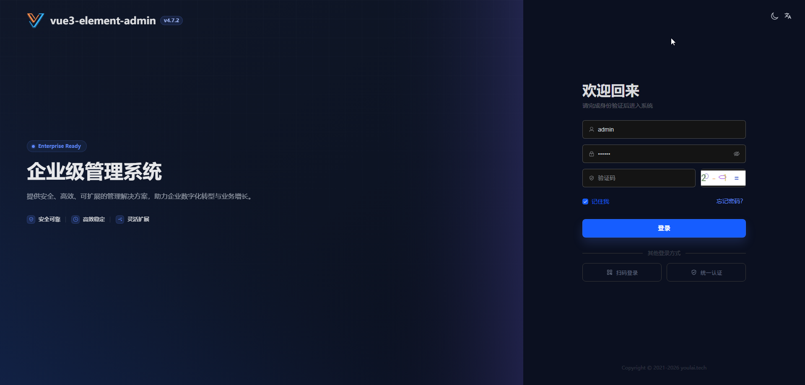
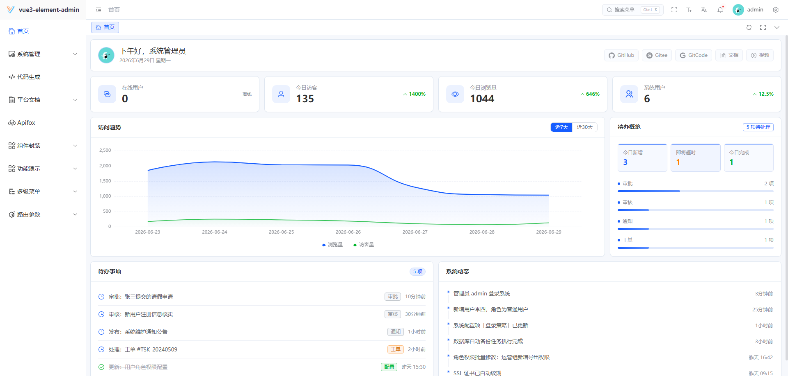
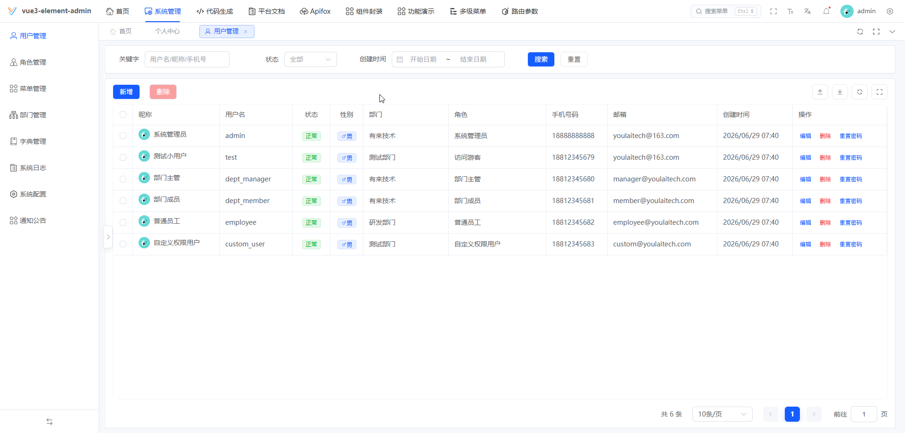
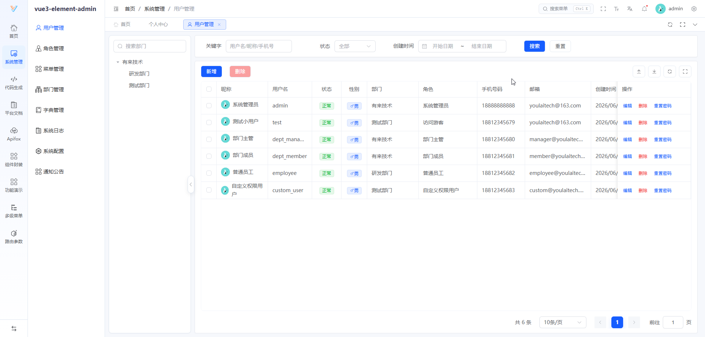
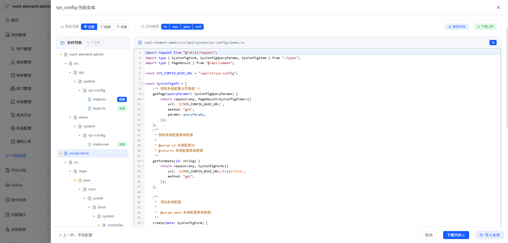
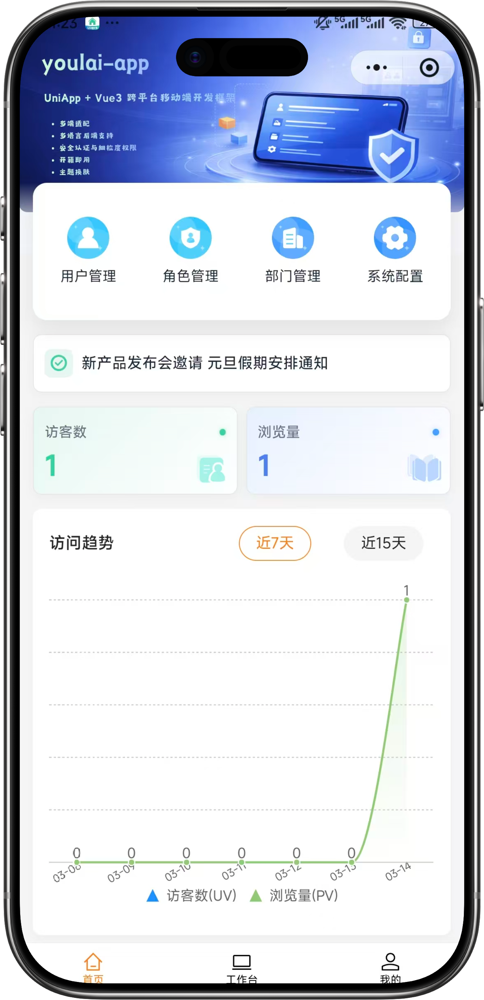
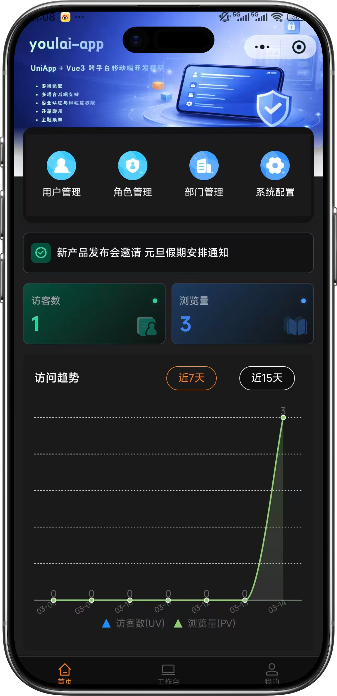
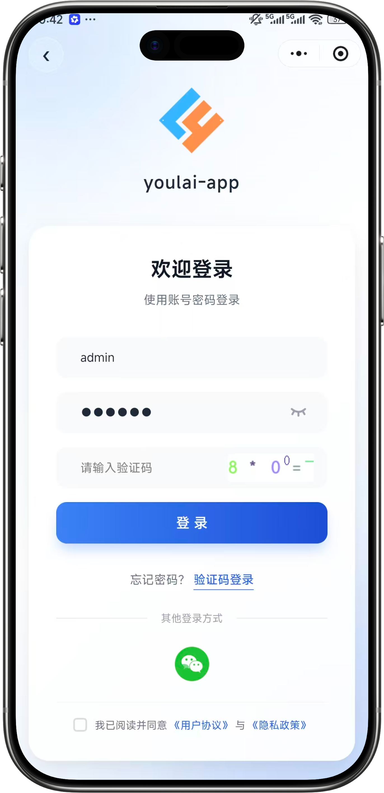
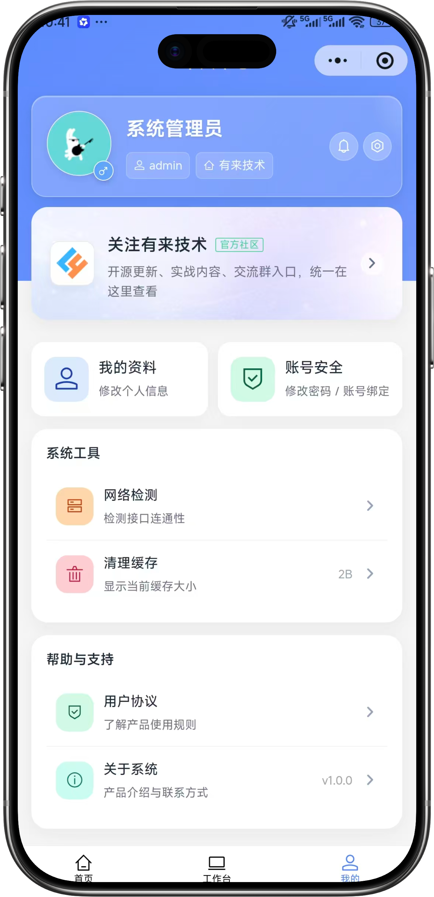

<div align="center">

#  youlai-django

**Python 3.12 + Django 6.0 企业级权限管理系统后端**

<br>

[](https://www.python.org/)
[](https://www.djangoproject.com/)
[](LICENSE)
[](https://gitee.com/youlaiorg/youlai-django/stargazers)
[](https://github.com/youlaitech/youlai-django)

</div>

<p align="center"></p>

<div align="center">

[](https://admin.youlai.tech)
[](https://app.youlai.tech)
[](https://www.youlai.tech/docs/server/spring-boot/)
[](./README.en.md)

</div>

## 项目简介

**youlai-django** 是一套基于 Django 6.0 / DRF 的企业级权限管理系统后端，配套前端 [vue3-element-admin](https://gitee.com/youlaiorg/vue3-element-admin) 和移动端 [youlai-app](https://gitee.com/youlaiorg/youlai-app)，并提供 **7 种语言实现**（Java / Node.js / Go / Python / PHP / C# / Rust），共享同一套 API 规范与数据库结构。适用于企业中后台管理系统的学习参考与二次开发。

## 核心特性

- 🔐 **安全体系** — JWT + Redis Token 双会话模式、令牌续期、多端互斥
- 🛡️ **细粒度权限** — RBAC 权限模型，菜单/按钮/接口统一治理
- ⚡ **代码生成器** — 一键生成前后端 CRUD 代码
- 📦 **模块齐全** — 用户、角色、菜单、部门、字典、文件、消息中心、操作日志
- 🔌 **实时通信** — WebSocket 推送：在线用户数、字典同步、通知广播

## 系统预览

**PC 端**

<table align="center">
  <tr>
    <td></td>
    <td></td>
  </tr>
  <tr>
    <td></td>
    <td></td>
  </tr>
  <tr>
    <td></td>
    <td></td>
  </tr>
</table>

**移动端**

<table align="center">
  <tr>
    <td></td>
    <td></td>
    <td></td>
    <td></td>
  </tr>
</table>

## 快速开始

> 环境要求：Python 3.12+　·　MySQL 8.0+　·　Redis 7.x+

**1. 克隆项目**

```bash
git clone https://gitee.com/youlaiorg/youlai-django.git
cd youlai-django
```

**2. 创建虚拟环境**

Windows（PowerShell）：
```powershell
python -m venv venv
venv\Scripts\activate
```

macOS / Linux：
```bash
python3 -m venv venv
source venv/bin/activate
```

**3. 安装依赖**

```bash
pip install -r requirements.txt
```

**4. 导入数据库**

用 `sql/mysql/youlai_admin_django.sql` 创建业务表与初始化数据（表单模块扩展表见 `sql/mysql/extensions/dynamic-form.sql`）。再执行一次迁移命令，用于创建 Django 内置框架表（auth / contenttypes / sessions / admin），不会改动业务表：

```bash
python manage.py migrate
```

> **使用 PostgreSQL**：`sql/postgresql/` 下是同源脚本（由 `youlai-devkit/scripts/gen_pg_from_mysql.py` 从 MySQL 脚本生成，**勿手工编辑**）；把 `.env` 里的 `DB_ENGINE` 改为 `postgresql`（端口默认 5432）、安装 `psycopg` 即可，导入顺序同样是「先导入 SQL，再 migrate」。两方言一致性可用 `python youlai-devkit/scripts/check_sql_parity.py` 校验。

> 项目不维护迁移脚本，业务表结构以 SQL 脚本为准。以后修改模型时执行 `python manage.py makemigrations` 生成迁移，再用 `python manage.py migrate --fake-initial` 应用（已存在的表只记录迁移状态，不会重复建表）。

**5. 配置文件**（可选）

仓库已提供 `.env`，按需修改数据库/Redis 连接信息，默认配置开箱即用。

**6. 启动服务**

**方式一：PyCharm 启动（推荐）**
用 PyCharm 打开项目并选中虚拟环境，点击 `manage.py` 的 `runserver` 运行配置即可。

**方式二：命令行启动**
```bash
python manage.py runserver 8000
```
打开 http://localhost:8000/api/docs/swagger/ ，默认账号 `admin` / `123456`。

**7. 启动前端（可选）**
如需可视化操作界面，启动配套前端 [vue3-element-admin](https://gitee.com/youlaiorg/vue3-element-admin)，访问 [http://localhost:3000](http://localhost:3000)，使用 `admin` / `123456` 登录。

> 更多内容详见官方文档：[快速开始](https://www.youlai.tech/docs/server/django/quick-start.html) · [部署指南](https://www.youlai.tech/docs/server/django/deploy.html)

## 目录结构

```
youlai-django/
├── apps/                           # 业务应用（模块化）
│   ├── auth/                       # 认证模块（登录/Token/微信小程序）
│   ├── system/                     # 系统核心模块（用户/角色/菜单/部门/字典/通知/日志）
│   ├── file/                       # 文件上传
│   ├── codegen/                    # 代码生成
│   └── message/                    # SSE 消息推送
├── config/                         # 项目配置
│   ├── settings/                   # 环境配置（base/dev/prod）
│   ├── urls.py                     # 全局路由
│   ├── asgi.py                     # ASGI 入口
│   └── wsgi.py                     # WSGI 入口
├── core/                           # 公共基础能力
│   ├── exceptions/                 # 异常处理
│   ├── permissions/                # 权限控制
│   ├── middleware/                 # 中间件
│   ├── response.py                 # 统一响应格式
│   ├── viewsets.py                 # 基础视图集
│   └── pagination.py               # 分页器
├── sql/                            # 数据库初始化脚本
├── manage.py                       # Django 管理入口
└── .env                            # 环境变量
```

## 生态矩阵

**前端**

| 项目 | 技术栈 | 说明 | 更新状态 |
|:-----|:-------|:-----|:---------|
| [vue3-element-admin](https://gitee.com/youlaiorg/vue3-element-admin) | Vue 3 + Element Plus | PC 管理前端（主推） | ✅️ |
| [youlai-app](https://gitee.com/youlaiorg/youlai-app) | Vue 3 + UniApp | 移动端 App | ✅️ |

**后端**

| 项目 | 技术栈 | 说明 | 更新状态 |
|:-----|:-------|:-----|:---------|
| [youlai-boot](https://gitee.com/youlaiorg/youlai-boot) | Spring Boot + MyBatis-Plus | Java（主推） | ✅️ |
| [youlai-nest](https://gitee.com/youlaiorg/youlai-nest) | NestJS + TypeORM | Node.js | ✅️ |
| [youlai-gin](https://gitee.com/youlaiorg/youlai-gin) | Go + Gorm | Go | ✅️ |
| [youlai-django](https://gitee.com/youlaiorg/youlai-django) | Django + DRF | Python | ✅️ |
| [youlai-fastapi](https://gitee.com/youlaiorg/youlai-fastapi) | FastAPI + SQLAlchemy | Python | ✅️ |
| [youlai-think](https://gitee.com/youlaiorg/youlai-think) | ThinkPHP + ThinkORM | PHP | ✅️ |
| [youlai-aspnet](https://gitee.com/youlaiorg/youlai-aspnet) | ASP.NET Core + EF Core | C# | ✅️ |
| [youlai-axum](https://gitee.com/youlaiorg/youlai-axum) | Axum + SeaORM | Rust | ✅️ |
| [youlai-laravel](https://gitee.com/youlaiorg/youlai-laravel) | Laravel + Eloquent | PHP | ❌️ |

> 九种后端共享同一套 **RESTful API 规范** 和 **数据库结构**，前端可无缝切换。

**衍生版本**

| 项目 | 基于 | 类型 | 说明 | 更新状态 |
|:-----|:-----|:-----|:-----|:---------|
| [youlai-boot-tenant](https://gitee.com/youlaiorg/youlai-boot-tenant) | youlai-boot | 独立仓库 | 多租户 SaaS，租户隔离与租户配置 | ✅️ |
| [youlai-boot-flex](https://gitee.com/youlaiorg/youlai-boot-flex) | youlai-boot | 独立仓库 | 改用 MyBatis-Flex | ✅️ |
| [youlai-boot (db-pg)](https://gitee.com/youlaiorg/youlai-boot/tree/db-pg) | youlai-boot | 分支 | PostgreSQL 数据库分支 | ✅️ |
| [youlai-boot (multi-module)](https://gitee.com/youlaiorg/youlai-boot/tree/multi-module) | youlai-boot | 分支 | 多模块工程拆分 | ✅️ |
| [youlai-nest (multi-tenant)](https://gitee.com/youlaiorg/youlai-nest/tree/multi-tenant) | youlai-nest | 分支 | 多租户 SaaS，租户隔离与租户配置 | ✅️ |
| [youlai-boot (spring-boot-3)](https://gitee.com/youlaiorg/youlai-boot/tree/spring-boot-3) | youlai-boot | 分支 | Spring Boot 3 兼容分支 | ❌️ |

## 可选扩展

**AI 辅助（默认关闭）**：`.env` 中打开开关并填写密钥，`config/settings` 读取这些变量。

```env
AI_ENABLED=true
AI_API_KEY=sk-xxx
```

## 技术合作

本项目采用 [Apache License 2.0](LICENSE) 开源，可免费商用。欢迎在 [Issue](https://gitee.com/youlaiorg/youlai-django/issues) 提交问题或反馈，也欢迎提交 [Pull Request](https://gitee.com/youlaiorg/youlai-django/pulls) 共建。

如需技术支持、商务合作、二次开发、项目定制或私有化部署，可联系作者微信（见下方二维码）。

<table align="center">
  <tr>
    <td align="center">
      <br>
      <sub>公众号「有来技术」</sub>
    </td>
    <td>&nbsp;&nbsp;&nbsp;&nbsp;</td>
    <td align="center">
      <br>
      <sub>小程序「有来技术」</sub>
    </td>
    <td>&nbsp;&nbsp;&nbsp;&nbsp;</td>
    <td align="center">
      <br>
      <sub>添加作者微信</sub>
    </td>
  </tr>
</table>

<p align="center"><em>技术交流 · 问题反馈 · 商务合作</em></p>
